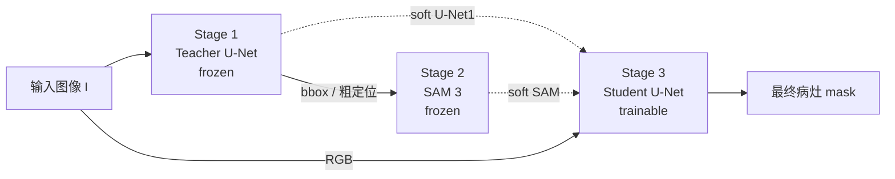

<div align="center">

**简体中文** · [English](README_EN.md)

# BUS-Lesion-Seg

**乳腺超声病灶分割 · Breast Ultrasound Lesion Segmentation**

将 U-Net 的域内定位能力与 SAM 3 的通用边界感知能力结合，构建从训练、推理到评估的完整实验框架。

[](https://www.python.org/)
[](https://pytorch.org/)


[项目简介](#项目简介) · [相关工作](#相关工作) · [方法概览](#方法概览) · [快速开始](#快速开始) · [实验结果](#实验结果) · [模块说明](#模块说明)

</div>

---

## 项目简介

本项目面向乳腺超声图像中的病灶分割任务，主要目标是探索通用视觉基础模型在医学小样本场景中的迁移能力。

仓库以 U-Net 作为域内定位基线，以 SAM 3 / MedSAM 作为基础模型对照，并通过 **Sandwich Architecture** 将 U-Net 的病灶语义定位能力与 SAM 的边界细化能力结合，覆盖训练、推理、评估与论文实验分析的完整流程。

| 维度 | 说明 |
| --- | --- |
| 任务 | 乳腺超声病灶二分类语义分割 |
| 数据 | BUID / BUSC / BUSUC / UDIAT，外部测试集共 1,456 张图像 |
| 模型 | U-Net (ResNet34) · SAM 3 (+LoRA) · MedSAM · Sandwich V1/V2 |
| 指标 | Dice Similarity Coefficient (DSC) / Intersection over Union (IoU) |
| 文档 | 方法细节见 [`Sandwich_Architecture_Methodology.md`](Sandwich_Architecture_Methodology.md) |

## 项目亮点

- **Sandwich Architecture**：三阶段级联框架。冻结的 Teacher U-Net 生成定位先验，SAM 3 细化边界，再由可训练的 Student U-Net 完成最终融合。
- **蒸馏与 LoRA 微调**：支持 Teacher 引导的蒸馏训练与 GT-only 对照，并提供 LoRA / full-decoder fine-tuning 两种策略。
- **多数据集外部验证**：在 BUID、BUSC、BUSUC、UDIAT 四个来源的数据集上统一评估，报告 Dice / IoU 与 Dice > 0.7 的样本比例。
- **完整实验工具链**：预计算、消融图、显著性检验、bad case 分析与 qualitative figure 渲染脚本一应俱全。

## 相关工作

**医学图像分割与 U-Net。** U-Net 通过编码器-解码器结构与跳跃连接奠定了生物医学图像分割的基础 [1]；nnU-Net 进一步将预处理、网络结构与训练策略自动化 [2]。在乳腺超声等小样本场景中，U-Net 类模型仍是强基线，但其定位能力受限于域内标注规模。

**通用分割基础模型。** SAM 将可提示分割扩展到大规模数据 [3]，SAM 3 进一步引入概念提示并提升通用目标分割能力 [4]。MedSAM [5] 与 SAM-Med2D [6] 将 SAM 适配到医学图像；UltraSam [7] 则利用大规模开放超声数据构建超声专用基础模型。这些模型提供了强边界先验，但在低对比度、强噪声的超声图像上仍可能出现边界漂移与域偏移。

**参数高效微调与知识蒸馏。** LoRA 通过低秩适配器降低大模型微调成本 [8]；知识蒸馏将 Teacher 的软输出迁移给 Student [9]。本项目将二者结合：Teacher U-Net 提供 box prompt 与软监督，SAM 3 的 Mask Decoder 通过 LoRA 或 full-decoder 微调适配超声域，并用 GT-only 对照分离蒸馏收益。

**乳腺超声分割与本项目定位。** 乳腺超声分割已有大量 U-Net 变体与公开数据集（如 BUSI [10]）。与直接微调单一分割模型不同，本项目将冻结的 U-Net 定位、SAM 3 边界细化与轻量 Student U-Net 融合组织为三阶段 Sandwich 流程，并在 BUID、BUSC、BUSUC、UDIAT 四个外部集上统一评估，重点考察基础模型在医学小样本场景中的可迁移性与融合收益。

### 参考文献

1. Ronneberger O., Fischer P., Brox T. U-Net: Convolutional Networks for Biomedical Image Segmentation. MICCAI 2015. [arXiv:1505.04597](https://arxiv.org/abs/1505.04597)
2. Isensee F., et al. nnU-Net: a self-configuring method for deep learning-based biomedical image segmentation. Nature Methods, 2021. [arXiv:1809.10486](https://arxiv.org/abs/1809.10486) · [DOI](https://doi.org/10.1038/s41592-020-01008-z)
3. Kirillov A., et al. Segment Anything. ICCV 2023. [arXiv:2304.02643](https://arxiv.org/abs/2304.02643)
4. Carion N., et al. SAM 3: Segment Anything with Concepts. arXiv:2511.16719, 2025. [arXiv](https://arxiv.org/abs/2511.16719)
5. Ma J., et al. Segment Anything in Medical Images. Nature Communications, 2024. [arXiv:2304.12306](https://arxiv.org/abs/2304.12306) · [DOI](https://doi.org/10.1038/s41467-024-44824-z)
6. Cheng J., et al. SAM-Med2D. arXiv:2308.16184, 2023. [arXiv](https://arxiv.org/abs/2308.16184)
7. Meyer A., et al. UltraSam: A Foundation Model for Ultrasound using Large Open-Access Segmentation Datasets. arXiv:2411.16222, 2024. [arXiv](https://arxiv.org/abs/2411.16222)
8. Hu E. J., et al. LoRA: Low-Rank Adaptation of Large Language Models. ICLR 2022. [arXiv:2106.09685](https://arxiv.org/abs/2106.09685)
9. Hinton G., Vinyals O., Dean J. Distilling the Knowledge in a Neural Network. arXiv:1503.02531, 2015. [arXiv](https://arxiv.org/abs/1503.02531)
10. Al-Dhabyani W., et al. Dataset of breast ultrasound images. Data in Brief, 2020. [DOI](https://doi.org/10.1016/j.dib.2019.104863)

## 方法概览

### Sandwich Architecture

Sandwich 将任务拆成三个阶段：Stage 1 / Stage 2 保持冻结，仅在 Stage 3 训练轻量 Student U-Net，从而避免端到端训练 SAM 3 带来的显存与算力开销。



1. **Stage 1 · 粗定位**：Teacher U-Net 输出概率图，二值化后取最小外接框作为 box prompt。
2. **Stage 2 · 边界细化**：将原图与 box prompt 送入 SAM 3，得到更贴合病灶边界的 mask。
3. **Stage 3 · 特征融合**：Student U-Net 融合原图与 Stage 1 / Stage 2 的输出，生成最终分割。

| 版本 | Student 输入 | 特点 |
| --- | --- | --- |
| V1 | RGB + 二值 SAM mask（4 通道） | 早期版本，使用硬 mask |
| **V2（推荐）** | RGB + soft SAM prob + soft U-Net1 prob（5 通道） | 保留概率信息，更接近推理时的真实分布 |

**训练策略**：Stage 1 / Stage 2 冻结，离线预计算 soft probability map，仅优化 Stage 3。V2 支持 `P_U1` 通道随机置零（`--p_u1_dropout`），以缓解 Student 对 U-Net1 的捷径依赖；推理阶段可选 A1 回退，在 V2 明显过分割时回退到 V1+LoRA mask。

## 项目结构

```text
BUS-Lesion-Seg/
├── src_unet/                         # Teacher U-Net 基线：训练、推理、视频/批量推理
├── src_distill/                      # SAM 3 蒸馏训练与推理（LoRA / full）
├── src_sandwich/                     # Sandwich V1/V2 多阶段融合模型
├── sam3/                             # SAM 3 相关模型代码与工具
├── scripts/                          # MedSAM、可视化、消融图、显著性检验等实验脚本
├── seg_utils/                        # Dice / IoU 统计工具
├── notebooks/                        # 实验验证 notebook
├── Experiments/                      # 各实验输出与统计结果（metrics.csv / statistics.csv）
├── inference_results_*/              # 若干推理结果目录
├── Test_Output/                      # 测试输出示例
├── Sandwich_Architecture_Methodology.md
└── checkpoints/                      # 模型权重目录（需自行创建，仓库不包含权重）
```

## 环境准备

### 依赖安装

建议使用 **Python 3.10+** 与 CUDA 环境。核心依赖：

```bash
pip install torch torchvision
pip install segmentation-models-pytorch monai numpy pandas matplotlib pillow \
  tqdm scikit-learn scikit-image scipy
```

若运行 SAM 3、MedSAM 或 LoRA 相关实验，还需按对应模型仓库补齐依赖与权重文件（如 `sam3.pt`、`medsam_vit_b.pth`）。仓库不包含任何模型权重或数据集。

> [!IMPORTANT]
> 代码中多处默认路径指向原作者服务器环境（例如 `/home/maia-user/yufeng/...`）。本地运行前，请优先检查并替换 `src_unet/config.py`、`src_distill/config.py` 中的 `DATA_ROOT`、`CHECKPOINT_DIR`、`SAM_CKPT`、`UNET_CKPT` 等字段，以及 `src_distill/train.py`、`src_sandwich/*` 中硬编码的权重路径，或在命令行显式传入对应参数。

## 数据准备

大多数脚本默认读取如下结构：

```text
DATA_ROOT/
├── images/
│   ├── BUSC_001.png
│   ├── BUID_002.png
│   └── ...
└── labels/
    ├── BUSC_001.png
    ├── BUID_002.png
    └── ...
```

- `images/` 存放输入图像，常用格式为 `.png` 或 `.jpg`。
- `labels/` 存放同名二值 mask；推理时允许缺失，此时只输出预测 mask 与可视化，不计算 Dice / IoU。
- 文件名前缀会被解析为数据集名称，例如 `BUSC_001.png` 属于 `BUSC`。
- 可通过 `Config.EXTERNAL_TEST_DATASETS` 或命令行 `--target_datasets` 指定外部测试集，例如 `BUSC,BUID,UDIAT,BUSUC`。

Sandwich V2 训练还需要缓存概率图：

```text
DATA_ROOT/
├── sam3_probs_lora/        # SAM 3（或 SAM 3 + LoRA）的 soft probability map
└── unet1_probs/            # Teacher U-Net 的 soft probability map
```

这两个目录由 `src_sandwich/precompute_masks_v2.py` 生成，详见[快速开始](#快速开始)。

## 快速开始

以下命令均在仓库根目录执行。

### 1. 获取代码

```bash
git clone https://github.com/DEYIF/BUS-Lesion-Seg.git
cd BUS-Lesion-Seg
```

### 2. 准备数据与权重

按上一节组织 `DATA_ROOT/images` 与 `DATA_ROOT/labels`，并将 SAM 3 基座权重放入 `checkpoints/sam3.pt`。若已有训练好的 Teacher、SAM 3 与 Sandwich 权重，可跳过训练，直接从第 7 步开始。

### 3. 训练 Teacher U-Net

```bash
python -m src_unet.train
```

训练脚本会按验证集 Dice 保存 `best_teacher_unet.pth` 到 `Config.CHECKPOINT_DIR`（示例中为 `checkpoints/`），并持续更新 `latest_teacher_unet.pth`。

### 4. 训练 SAM 3 LoRA（可选）

```bash
python -m src_distill.train \
  --epochs 50 \
  --batch_size 8 \
  --no_distillation \
  --finetune_type lora \
  --exp_tag sam3_gtonly
```

权重默认保存在 `ckpt_root/<exp_tag>/student_sam3_gtonly_lora.pth`。`ckpt_root` 在 `src_distill/train.py` 中默认指向服务器路径，请先改为本地 `checkpoints/`。将 `--no_distillation` 换成 `--use_distillation` 即可训练蒸馏版；若希望对齐结果表中的 SAM 3（full-decoder fine-tuning），将 `--finetune_type` 改为 `full`，此时权重文件名为 `student_sam3_gtonly_full.pth` / `student_sam3_distilled_full.pth`，后续命令中的 `_lora` 路径也需相应替换为 `_full`。

### 5. 预计算 Sandwich V2 所需概率图

```bash
python -m src_sandwich.precompute_masks_v2 \
  --teacher_ckpt checkpoints/best_teacher_unet.pth \
  --base_sam_ckpt checkpoints/sam3.pt \
  --sam_lora_ckpt checkpoints/sam3_gtonly/student_sam3_gtonly_lora.pth \
  --data_root /path/to/DATA_ROOT \
  --sam_probs_subdir sam3_probs_lora \
  --batch_size 8
```

若跳过第 4 步、直接使用原始 SAM 3，则改为 `--sam_lora_ckpt none --sam_probs_subdir sam3_probs`，并在下一步将 `--sam_prob_subdir` 设为 `sam3_probs`。

### 6. 训练 Sandwich V2

```bash
python -m src_sandwich.train_v2 \
  --data_root /path/to/DATA_ROOT \
  --sam_prob_subdir sam3_probs_lora \
  --epochs 150 \
  --batch_size 16 \
  --p_u1_dropout 0.3 \
  --save_path checkpoints/sandwich_unet2_v2.pth \
  --external_test_datasets BUSC,BUID,UDIAT,BUSUC
```

### 7. 推理与评估

```bash
python -m src_sandwich.inference_v2 \
  --teacher_ckpt checkpoints/best_teacher_unet.pth \
  --base_sam_ckpt checkpoints/sam3.pt \
  --unet2_ckpt checkpoints/sandwich_unet2_v2.pth \
  --sam_lora_ckpt checkpoints/sam3_gtonly/student_sam3_gtonly_lora.pth \
  --data_root /path/to/DATA_ROOT \
  --target_datasets BUSC,BUID,UDIAT,BUSUC \
  --output_root Experiments/sandwich_v2_lora
```

> [!NOTE]
> 上一步是纯 V2 推理。若需要复现实验中的 A1 回退结果，需要先有 V1+LoRA 的逐图 mask（`<dataset>/masks/<filename>.png`），再追加 `--enable_a1 --v1_mask_dir Experiments/sandwich_v1_lora`。

### 8. 汇总指标

```bash
python -m seg_utils.calculate_stats \
  Experiments/sandwich_v2_lora/metrics.csv \
  Experiments/sandwich_v2_lora/statistics.csv
```

完整参数与逐模块说明见下文[模块说明](#模块说明)。

## 实验结果

在 BUID / BUSC / BUSUC / UDIAT 四个外部测试集上的平均 Dice 与 IoU：

| 方法 | BUID | BUSC | BUSUC | UDIAT | Overall DSC | Overall IoU |
| --- | ---: | ---: | ---: | ---: | ---: | ---: |
| U-Net (Teacher) | 0.8999 | 0.8757 | 0.8993 | 0.8078 | 0.8851 | 0.8106 |
| SAM 3 (zero-shot) | 0.2031 | 0.1713 | 0.1935 | 0.0478 | 0.1749 | 0.1046 |
| SAM 3 (GT-only, decoder FT) | 0.7952 | 0.8569 | 0.8520 | 0.7861 | 0.8364 | 0.7444 |
| SAM 3 (Distilled, decoder FT) | 0.7941 | 0.8504 | 0.8499 | 0.7539 | 0.8303 | 0.7325 |
| Sandwich V1 (SAM 3) | 0.8681 | 0.8523 | 0.8778 | 0.7801 | 0.8609 | 0.7780 |
| Sandwich V2 | 0.9227 | 0.8733 | 0.9045 | 0.8149 | 0.8920 | 0.8207 |
| Sandwich V2 + LoRA | 0.9231 | **0.8770** | 0.9055 | 0.8237 | 0.8943 | 0.8239 |
| **Sandwich V2 + LoRA + P_U1 dropout + A1** | **0.9270** | 0.8769 | **0.9075** | **0.8387** | **0.8976** | **0.8279** |
| MedSAM (GT box) † | 0.9215 | 0.8876 | 0.9323 | 0.9160 | 0.9211 | 0.8569 |
| MedSAM (U-Net1 box) | 0.8901 | 0.8540 | 0.8970 | 0.7925 | 0.8768 | 0.8006 |

> [!NOTE]
> 表中 BUID–UDIAT 为平均 Dice，Overall IoU 为平均 IoU。U-Net、SAM 3 与 Sandwich 系列按 512×512 预处理尺寸计算指标；MedSAM 按其官方推理流程还原到原图尺寸后计算。SAM 3 两行为 full decoder fine-tuning（`--finetune_type full`，仅训练 Mask Decoder）。† MedSAM (GT box) 使用 GT 紧致框，属于 Oracle 协议，仅用于衡量“给定完美定位框”时的分割上界，不是可部署结果；该行统计 1,455 张图像（1 张空 GT 被跳过）。

### 结果解读

- **零样本 SAM 3 直接迁移效果有限**：Overall DSC 仅 0.1749，说明通用基础模型在低对比度、强噪声的乳腺超声域仍存在明显 domain gap，域内适配是必要的。
- **直接监督略优于蒸馏**：SAM 3 (GT-only, decoder FT) 的 0.8364 略高于 Distilled 的 0.8303，提示 Teacher 的不确定性可能干扰 Student；蒸馏策略仍有进一步设计空间。
- **Sandwich 融合有效**：Sandwich V2 + LoRA + P_U1 dropout + A1 达到 0.8976，较 U-Net Teacher 提升 1.25 个百分点，是可部署配置中的最佳结果。
- **Oracle 上界仍有距离**：MedSAM (GT box) 达到 0.9211，但依赖 GT 框；换成 U-Net1 自动框后降至 0.8768，说明定位质量仍是端到端性能的关键瓶颈。

逐图指标与完整实验记录见 [`Experiments/`](Experiments/)。

## 模块说明

### `src_unet` · Teacher U-Net 基线

训练 ResNet34 encoder 的 U-Net，作为基础分割模型，也作为 Sandwich 与蒸馏流程中的 Teacher。

| 文件 | 作用 |
| --- | --- |
| `config.py` | 数据路径、输出路径、训练参数与设备配置 |
| `dataset.py` | 数据扫描、划分、MONAI transform、外部测试集划分 |
| `model.py` | U-Net 构建函数 |
| `train.py` | Teacher U-Net 训练入口 |
| `inference.py` | 单模型推理入口，保存 mask、overlay 与指标 |
| `inference_video.py` / `inference_video_batch.py` / `inference_us3m.py` | 视频或特定数据源推理脚本 |

**训练**

```bash
python -m src_unet.train
```

**推理**

```bash
python -m src_unet.inference \
  --data-root /path/to/DATA_ROOT \
  --checkpoint checkpoints/best_teacher_unet.pth \
  --output-dir Experiments/unet
```

输出结构：

```text
OUTPUT_DIR/
├── metrics.csv
└── BUSC/
    ├── masks/
    └── overlays/
```

### `src_distill` · SAM 3 蒸馏与 GT-only 微调

以 Teacher U-Net 为 SAM 3 提供 box prompt，支持两种训练模式：

| 模式 | 参数 | 说明 |
| --- | --- | --- |
| 蒸馏版 | `--use_distillation` | Teacher 输出辅助训练 Student SAM 3 |
| GT-only | `--no_distillation` | 仅用 GT 监督，作为不使用蒸馏的对照 |

| 文件 | 作用 |
| --- | --- |
| `config.py` | Teacher U-Net、SAM 3 与数据路径配置 |
| `model.py` | Teacher U-Net 与 SAM 3 Student 的封装 |
| `loss.py` | 分割损失与蒸馏损失 |
| `train.py` | LoRA / full-decoder fine-tuning 训练入口 |
| `inference.py` | distilled / gtonly / original 三种模式推理入口 |

**训练蒸馏版（LoRA 示例）**

```bash
python -m src_distill.train \
  --epochs 50 \
  --batch_size 8 \
  --use_distillation \
  --finetune_type lora \
  --exp_tag sam3_distilled
```

**训练 GT-only 对照（LoRA 示例）**

```bash
python -m src_distill.train \
  --epochs 50 \
  --batch_size 8 \
  --no_distillation \
  --finetune_type lora \
  --exp_tag sam3_gtonly
```

`--finetune_type lora` 只训练 Mask Decoder 中的 LoRA adapter，显存占用更低；改为 `full` 则微调整个 Mask Decoder（结果表中的 SAM 3 蒸馏 / GT-only 采用该设置）。`--exp_tag` 会在 `ckpt_root` 下创建子目录，因此需先将 `src_distill/train.py` 中的 `ckpt_root` 改为本地 `checkpoints/`。

**推理**

```bash
python -m src_distill.inference \
  --mode distilled \
  --finetune_type lora \
  --teacher_ckpt checkpoints/best_teacher_unet.pth \
  --base_sam_ckpt checkpoints/sam3.pt \
  --student_ckpt checkpoints/sam3_distilled/student_sam3_distilled_lora.pth \
  --data_root /path/to/DATA_ROOT \
  --output_root Experiments/sam3_distilled
```

`--mode original` 可用于评估未微调的 SAM 3 基座模型。

### `src_sandwich` · Sandwich 多阶段融合模型

Sandwich Architecture 将模型分为三个阶段：

1. **Stage 1**：Teacher U-Net 生成粗定位 mask 或 box prompt。
2. **Stage 2**：SAM 3 根据 prompt 生成更贴合边界的 mask。
3. **Stage 3**：Student U-Net 融合原图、SAM 输出与 U-Net1 输出，生成最终分割。

V1 使用 `RGB + SAM mask` 的 4 通道输入；V2 改为 `RGB + soft_SAM + soft_UNet1` 的 5 通道输入，更贴近推理时的真实分布。**当前推荐优先使用 V2。**

#### 预计算 soft mask

训练 V2 前，先缓存 SAM 3 与 U-Net1 的概率图：

```bash
python -m src_sandwich.precompute_masks_v2 \
  --teacher_ckpt checkpoints/best_teacher_unet.pth \
  --base_sam_ckpt checkpoints/sam3.pt \
  --sam_lora_ckpt checkpoints/sam3_gtonly/student_sam3_gtonly_lora.pth \
  --data_root /path/to/DATA_ROOT \
  --sam_probs_subdir sam3_probs_lora \
  --batch_size 8
```

不使用 LoRA SAM 3 时，将 `--sam_lora_ckpt` 设为 `none`，并将 `--sam_probs_subdir` 设为 `sam3_probs`。

#### 训练 Sandwich V2

```bash
python -m src_sandwich.train_v2 \
  --data_root /path/to/DATA_ROOT \
  --sam_prob_subdir sam3_probs_lora \
  --epochs 150 \
  --batch_size 16 \
  --p_u1_dropout 0.3 \
  --save_path checkpoints/sandwich_unet2_v2.pth \
  --external_test_datasets BUSC,BUID,UDIAT,BUSUC
```

常用参数：

| 参数 | 说明 |
| --- | --- |
| `--resume` | 从 `--save_path` 严格恢复权重、优化器与 epoch |
| `--fine_tune_from` | 只加载已有权重，重新开始训练计划 |
| `--p_u1_dropout` | 训练时按样本随机置零 U-Net1 概率通道，缓解捷径依赖（推荐 0.3） |
| `--external_test_datasets` | 逗号分隔的外部测试集名称 |

#### 推理 Sandwich V2

```bash
python -m src_sandwich.inference_v2 \
  --teacher_ckpt checkpoints/best_teacher_unet.pth \
  --base_sam_ckpt checkpoints/sam3.pt \
  --unet2_ckpt checkpoints/sandwich_unet2_v2.pth \
  --sam_lora_ckpt checkpoints/sam3_gtonly/student_sam3_gtonly_lora.pth \
  --data_root /path/to/DATA_ROOT \
  --target_datasets BUSC,BUID,UDIAT,BUSUC \
  --output_root Experiments/sandwich_v2_lora
```

自适应回退策略：

| 模式 | 行为 |
| --- | --- |
| `legacy`（默认） | Student 预测为空时回退到 U-Net1；开启 `--enable_a1` 后，当 V2 面积明显大于 V1+LoRA mask 时可回退到 V1 结果 |
| `swap` | Student 为空时回退到 SAM 3 + LoRA；过分割时回退到 U-Net1 |

开启 A1 回退时，在上一节推理命令末尾追加 `--enable_a1 --v1_mask_dir Experiments/sandwich_v1_lora`，并将 `--output_root` 改为 `Experiments/sandwich_v2_lora_a1`。

> [!TIP]
> `--enable_a1` 默认在 `v2_area > 1.5 * v1_area` 且 `v1_area > 1%` 图像面积时触发。可通过 `--a1_over_ratio` 与 `--a1_v1_min_area` 调整。

### `scripts` · 实验、对照与可视化

| 脚本 | 作用 |
| --- | --- |
| `medsam_inference.py` | MedSAM 对照实验，支持 GT box 或 U-Net1 box prompt |
| `significance_test.py` | 对不同方法结果做显著性检验 |
| `visualize_bad_cases.py` | 按 Dice 阈值筛选并可视化 bad cases |
| `plot_v2_ablation_bars.py` | 绘制 V2 消融实验柱状图 |
| `plot_channel_dropout_batch.py` | 绘制 P_U1 dropout 相关实验图 |
| `plot_hard_vs_soft.py` | 对比 hard / soft mask 输入 |
| `render_qualitative_figure.py` | 生成论文 / 报告用 qualitative figure |
| `compose_v2_a1.py` | 合成 V2 + A1 回退结果 |
| `simulate_a1_rules.py` | 离线扫描 A1 回退规则 |
| `make_bad_case_categories_figure.py` | 生成 bad case 分类图 |
| `plot_v2_fallback_demo.py` | 绘制回退策略示意 |

**MedSAM 对照**

使用 GT 紧致框（Oracle 协议）：

```bash
python scripts/medsam_inference.py \
  --data_root /path/to/DATA_ROOT \
  --ckpt checkpoints/medsam_vit_b.pth \
  --output_root inference_results_medsam \
  --datasets BUSC BUID UDIAT BUSUC \
  --box_source gt
```

使用 Teacher U-Net 生成提示框：

```bash
python scripts/medsam_inference.py \
  --box_source unet1 \
  --unet1_ckpt checkpoints/best_teacher_unet.pth
```

> [!NOTE]
> MedSAM 脚本默认从 `/home/maia-user/yufeng/medsam_repo` 导入官方 `segment_anything`，运行前请修改 `scripts/medsam_inference.py` 中的 `MEDSAM_REPO` 路径。

## 评估与统计

推理脚本通常会在输出目录保存：

```text
OUTPUT_DIR/
├── metrics.csv            # 每张图的 Dice、IoU
├── statistics.csv         # 分数据集与总体统计（部分脚本自动生成）
├── metrics_summary.csv    # MedSAM 等脚本的汇总统计
└── <Dataset>/
    ├── masks/             # 二值预测 mask
    └── overlays/          # 原图、预测与 GT 叠加可视化
```

手动统计：

```bash
python -m seg_utils.calculate_stats \
  Experiments/sandwich_v2/metrics.csv \
  Experiments/sandwich_v2/statistics.csv
```

统计字段包括样本数、均值、中位数、方差、标准差、最小值、最大值，以及 Dice / IoU 大于 0.7 的数量和比例。

推理时保存的 mask 通常会被 resize 回原图尺寸；指标在统一的 512×512 预处理尺寸上计算，便于不同方法公平比较（MedSAM 例外，见[实验结果](#实验结果)注释）。

## 常见问题

<details>
<summary>没有 GPU 可以运行吗？</summary>

大部分脚本默认使用 `cuda`。没有 GPU 时，请将设备改为 `cpu` 或传入对应参数；SAM 3 在 CPU 上推理会非常慢，不建议用于完整实验。

</details>

<details>
<summary>为什么训练保存的权重名和下游脚本默认路径不一致？</summary>

`src_unet.train` 默认保存 `best_teacher_unet.pth`，而部分下游脚本的默认路径使用 `best_teacher_unet_BUSC_BUID_UDIAT_BUSUC.pth`。请重命名权重，或在命令中通过 `--teacher_ckpt` 显式指定。

</details>

<details>
<summary>训练 Sandwich V2 时提示缺少概率图目录？</summary>

`src_sandwich/train_v2.py` 依赖 `sam3_probs_lora/`（或 `sam3_probs/`）与 `unet1_probs/`。请先运行 `python -m src_sandwich.precompute_masks_v2 ...` 生成缓存。

</details>

<details>
<summary>推理时没有 labels 会怎样？</summary>

推理仍会正常输出预测 mask 与 overlay，但会跳过 Dice / IoU 计算。`labels/` 文件名应尽量与 `images/` 完全一致。

</details>

<details>
<summary>src_unet/README.md 出现乱码怎么办？</summary>

该文件存在历史编码问题，请以本 README 为主要使用说明。

</details>

## 引用

如果本项目对你的研究或工程有帮助，欢迎引用：

```bibtex
@misc{deyif2026buslesionseg,
  title        = {BUS-Lesion-Seg: Breast Ultrasound Lesion Segmentation with Foundation Models},
  author       = {DEYIF},
  year         = {2026},
  howpublished = {\url{https://github.com/DEYIF/BUS-Lesion-Seg}}
}
```

## 致谢

本项目建立在以下开源工作之上：

- [SAM 3](https://github.com/facebookresearch/sam3) — Segment Anything Model 3
- [MedSAM](https://github.com/bowang-lab/MedSAM) — Segment Anything in Medical Images
- [segmentation_models.pytorch](https://github.com/qubvel-org/segmentation_models.pytorch) — U-Net / ResNet 实现
- [MONAI](https://monai.io/) — 医学图像预处理与训练工具

## 许可证

本仓库当前未附带开源许可证。如需复用代码或用于商业用途，请先联系仓库作者。

---

<p align="center">如果本项目对你有帮助，欢迎点一个 ⭐ Star。</p>
