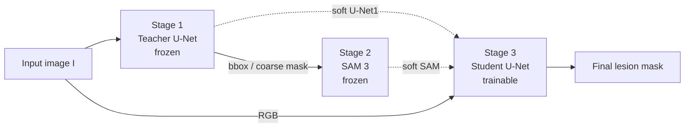

<div align="center">

**English** · [简体中文](README.md)

# BUS-Lesion-Seg

**Breast Ultrasound Lesion Segmentation**

Combining U-Net's in-domain localization with SAM 3's general-purpose boundary perception into a complete training, inference, and evaluation framework.

[](https://www.python.org/)
[](https://pytorch.org/)


[Overview](#overview) · [Related Work](#related-work) · [Method](#method) · [Quick Start](#quick-start) · [Results](#results) · [Modules](#modules)

</div>

---

## Overview

This project targets lesion segmentation in breast ultrasound images and explores how general-purpose vision foundation models transfer to small-data medical settings.

The repository uses U-Net as an in-domain localization baseline and SAM 3 / MedSAM as foundation-model baselines. The **Sandwich Architecture** combines U-Net's lesion-aware localization with SAM's boundary refinement, covering the complete workflow from training and inference to evaluation and paper-ready analysis.

| Aspect | Details |
| --- | --- |
| Task | Binary semantic segmentation of breast ultrasound lesions |
| Data | BUID / BUSC / BUSUC / UDIAT; 1,456 external test images |
| Models | U-Net (ResNet34) · SAM 3 (+LoRA) · MedSAM · Sandwich V1/V2 |
| Metrics | Dice Similarity Coefficient (DSC) / Intersection over Union (IoU) |
| Docs | Method details in [`Sandwich_Architecture_Methodology.md`](Sandwich_Architecture_Methodology.md) |

## Highlights

- **Sandwich Architecture**: A three-stage cascade. A frozen Teacher U-Net provides localization priors, SAM 3 refines boundaries, and a trainable Student U-Net performs the final fusion.
- **Distillation and LoRA fine-tuning**: Teacher-guided distillation and a GT-only control, with both LoRA and full-decoder fine-tuning strategies.
- **Multi-dataset external validation**: Unified evaluation on BUID, BUSC, BUSUC, and UDIAT, reporting Dice / IoU and the proportion of samples with Dice > 0.7.
- **Complete experiment toolchain**: Precomputation, ablation plots, significance tests, bad-case analysis, and qualitative figure rendering.

## Related Work

**Medical image segmentation and U-Net.** U-Net established encoder-decoder architectures with skip connections for biomedical image segmentation [1], and nnU-Net further automated preprocessing, network design, and training [2]. On small breast ultrasound datasets, U-Net-style models remain strong baselines, but their localization quality is limited by in-domain annotation scale.

**General-purpose segmentation foundation models.** SAM scaled promptable segmentation to large datasets [3], and SAM 3 extends it with concept prompts and more general target segmentation [4]. MedSAM [5] and SAM-Med2D [6] adapt SAM to medical images; UltraSam [7] builds an ultrasound-specific foundation model from large open-access ultrasound datasets. These models provide strong boundary priors, but low-contrast, noisy ultrasound images can still cause boundary drift and domain shift.

**Parameter-efficient fine-tuning and distillation.** LoRA reduces the cost of adapting large models with low-rank adapters [8], while knowledge distillation transfers soft Teacher outputs to a Student [9]. This project combines both: the Teacher U-Net supplies box prompts and soft supervision, the SAM 3 Mask Decoder is adapted to ultrasound via LoRA or full-decoder fine-tuning, and a GT-only control isolates the benefit of distillation.

**Breast ultrasound segmentation and this work.** Breast ultrasound segmentation has a long line of U-Net variants and public datasets such as BUSI [10]. Instead of fine-tuning a single segmentation model, this project organizes frozen U-Net localization, SAM 3 boundary refinement, and a lightweight Student U-Net into a three-stage Sandwich pipeline, and evaluates it uniformly on four external sets (BUID, BUSC, BUSUC, UDIAT), focusing on the transferability and fusion benefit of foundation models in small-data medical settings.

### References

1. Ronneberger O., Fischer P., Brox T. U-Net: Convolutional Networks for Biomedical Image Segmentation. MICCAI 2015. [arXiv:1505.04597](https://arxiv.org/abs/1505.04597)
2. Isensee F., et al. nnU-Net: a self-configuring method for deep learning-based biomedical image segmentation. Nature Methods, 2021. [arXiv:1809.10486](https://arxiv.org/abs/1809.10486) · [DOI](https://doi.org/10.1038/s41592-020-01008-z)
3. Kirillov A., et al. Segment Anything. ICCV 2023. [arXiv:2304.02643](https://arxiv.org/abs/2304.02643)
4. Carion N., et al. SAM 3: Segment Anything with Concepts. arXiv:2511.16719, 2025. [arXiv](https://arxiv.org/abs/2511.16719)
5. Ma J., et al. Segment Anything in Medical Images. Nature Communications, 2024. [arXiv:2304.12306](https://arxiv.org/abs/2304.12306) · [DOI](https://doi.org/10.1038/s41467-024-44824-z)
6. Cheng J., et al. SAM-Med2D. arXiv:2308.16184, 2023. [arXiv](https://arxiv.org/abs/2308.16184)
7. Meyer A., et al. UltraSam: A Foundation Model for Ultrasound using Large Open-Access Segmentation Datasets. arXiv:2411.16222, 2024. [arXiv](https://arxiv.org/abs/2411.16222)
8. Hu E. J., et al. LoRA: Low-Rank Adaptation of Large Language Models. ICLR 2022. [arXiv:2106.09685](https://arxiv.org/abs/2106.09685)
9. Hinton G., Vinyals O., Dean J. Distilling the Knowledge in a Neural Network. arXiv:1503.02531, 2015. [arXiv](https://arxiv.org/abs/1503.02531)
10. Al-Dhabyani W., et al. Dataset of breast ultrasound images. Data in Brief, 2020. [DOI](https://doi.org/10.1016/j.dib.2019.104863)

## Method

### Sandwich Architecture

Sandwich divides the pipeline into three stages: Stage 1 and Stage 2 remain frozen, and only the lightweight Stage 3 Student U-Net is trained. This avoids the memory and compute cost of end-to-end SAM 3 training.



1. **Stage 1 · Coarse localization**: The Teacher U-Net outputs a probability map; after binarization, the minimal bounding box is used as the box prompt.
2. **Stage 2 · Boundary refinement**: The image and box prompt are fed to SAM 3 to produce a mask that follows lesion boundaries more closely.
3. **Stage 3 · Feature fusion**: The Student U-Net fuses the image with the Stage 1 / Stage 2 outputs to produce the final segmentation.

| Version | Student input | Notes |
| --- | --- | --- |
| V1 | RGB + binary SAM mask (4 channels) | Early version using hard masks |
| **V2 (recommended)** | RGB + soft SAM prob + soft U-Net1 prob (5 channels) | Retains probability information and better matches the inference-time distribution |

**Training strategy**: Stage 1 / Stage 2 are frozen, soft probability maps are precomputed offline, and only Stage 3 is optimized. V2 supports per-sample dropout of the `P_U1` channel (`--p_u1_dropout`) to reduce the Student's shortcut reliance on U-Net1. At inference, an optional A1 fallback reverts to the V1+LoRA mask when V2 clearly over-segments.

## Project Structure

```text
BUS-Lesion-Seg/
├── src_unet/                         # Teacher U-Net baseline: training, inference, video/batch inference
├── src_distill/                      # SAM 3 distillation training and inference (LoRA / full)
├── src_sandwich/                     # Sandwich V1/V2 multi-stage fusion models
├── sam3/                             # SAM 3 model code and utilities
├── scripts/                          # MedSAM, visualization, ablation, and significance-test scripts
├── seg_utils/                        # Dice / IoU statistics utilities
├── notebooks/                        # Experiment verification notebooks
├── Experiments/                      # Experiment outputs and statistics (metrics.csv / statistics.csv)
├── inference_results_*/              # Inference result directories
├── Test_Output/                      # Example test outputs
├── Sandwich_Architecture_Methodology.md
└── checkpoints/                      # Model weights (create manually; weights are not included)
```

## Environment

### Dependencies

Python 3.10+ and a CUDA environment are recommended. Core dependencies:

```bash
pip install torch torchvision
pip install segmentation-models-pytorch monai numpy pandas matplotlib pillow \
  tqdm scikit-learn scikit-image scipy
```

To run SAM 3, MedSAM, or LoRA experiments, also install the dependencies and weights required by the corresponding model repositories (e.g., `sam3.pt`, `medsam_vit_b.pth`). This repository does not include model weights or datasets.

> [!IMPORTANT]
> Many default paths point to the original author's server environment (e.g., `/home/maia-user/yufeng/...`). Before running locally, check and replace `DATA_ROOT`, `CHECKPOINT_DIR`, `SAM_CKPT`, `UNET_CKPT`, etc. in `src_unet/config.py` and `src_distill/config.py`, as well as the hard-coded checkpoint paths in `src_distill/train.py` and `src_sandwich/*`; alternatively, pass the corresponding arguments on the command line.

## Data Preparation

Most scripts expect the following layout:

```text
DATA_ROOT/
├── images/
│   ├── BUSC_001.png
│   ├── BUID_002.png
│   └── ...
└── labels/
    ├── BUSC_001.png
    ├── BUID_002.png
    └── ...
```

- `images/` contains input images, usually in `.png` or `.jpg` format.
- `labels/` contains binary masks with matching filenames. Labels are optional at inference time; when they are missing, only predicted masks and visualizations are written, and Dice / IoU computation is skipped.
- The filename prefix is parsed as the dataset name; for example, `BUSC_001.png` belongs to `BUSC`.
- Use `Config.EXTERNAL_TEST_DATASETS` or the `--target_datasets` command-line option to select external test sets, e.g. `BUSC,BUID,UDIAT,BUSUC`.

Sandwich V2 training also requires cached probability maps:

```text
DATA_ROOT/
├── sam3_probs_lora/        # Soft probability maps from SAM 3 (or SAM 3 + LoRA)
└── unet1_probs/            # Soft probability maps from the Teacher U-Net
```

These directories are produced by `src_sandwich/precompute_masks_v2.py`; see [Quick Start](#quick-start).

## Quick Start

Run all commands from the repository root.

### 1. Clone the repository

```bash
git clone https://github.com/DEYIF/BUS-Lesion-Seg.git
cd BUS-Lesion-Seg
```

### 2. Prepare data and weights

Organize `DATA_ROOT/images` and `DATA_ROOT/labels` as described above, and place the SAM 3 base checkpoint at `checkpoints/sam3.pt`. If you already have trained Teacher, SAM 3, and Sandwich checkpoints, skip training and start from step 7.

### 3. Train the Teacher U-Net

```bash
python -m src_unet.train
```

The training script saves `best_teacher_unet.pth` to `Config.CHECKPOINT_DIR` (shown as `checkpoints/` here) and keeps `latest_teacher_unet.pth` updated.

### 4. Train SAM 3 LoRA (optional)

```bash
python -m src_distill.train \
  --epochs 50 \
  --batch_size 8 \
  --no_distillation \
  --finetune_type lora \
  --exp_tag sam3_gtonly
```

Weights are saved to `ckpt_root/<exp_tag>/student_sam3_gtonly_lora.pth` by default. `ckpt_root` in `src_distill/train.py` points to the original server path; change it to a local `checkpoints/` first. Replace `--no_distillation` with `--use_distillation` to train the distilled variant. To match the SAM 3 numbers in the results table (full-decoder fine-tuning), set `--finetune_type full`; the checkpoint names become `student_sam3_gtonly_full.pth` / `student_sam3_distilled_full.pth`, and subsequent `_lora` paths must be replaced with `_full`.

### 5. Precompute the probability maps for Sandwich V2

```bash
python -m src_sandwich.precompute_masks_v2 \
  --teacher_ckpt checkpoints/best_teacher_unet.pth \
  --base_sam_ckpt checkpoints/sam3.pt \
  --sam_lora_ckpt checkpoints/sam3_gtonly/student_sam3_gtonly_lora.pth \
  --data_root /path/to/DATA_ROOT \
  --sam_probs_subdir sam3_probs_lora \
  --batch_size 8
```

If you skip step 4 and use the original SAM 3, change to `--sam_lora_ckpt none --sam_probs_subdir sam3_probs`, and set `--sam_prob_subdir` to `sam3_probs` in the next step.

### 6. Train Sandwich V2

```bash
python -m src_sandwich.train_v2 \
  --data_root /path/to/DATA_ROOT \
  --sam_prob_subdir sam3_probs_lora \
  --epochs 150 \
  --batch_size 16 \
  --p_u1_dropout 0.3 \
  --save_path checkpoints/sandwich_unet2_v2.pth \
  --external_test_datasets BUSC,BUID,UDIAT,BUSUC
```

### 7. Inference and evaluation

```bash
python -m src_sandwich.inference_v2 \
  --teacher_ckpt checkpoints/best_teacher_unet.pth \
  --base_sam_ckpt checkpoints/sam3.pt \
  --unet2_ckpt checkpoints/sandwich_unet2_v2.pth \
  --sam_lora_ckpt checkpoints/sam3_gtonly/student_sam3_gtonly_lora.pth \
  --data_root /path/to/DATA_ROOT \
  --target_datasets BUSC,BUID,UDIAT,BUSUC \
  --output_root Experiments/sandwich_v2_lora
```

> [!NOTE]
> The command above runs pure V2 inference. To reproduce the A1 fallback result, first generate per-image V1+LoRA masks (`<dataset>/masks/<filename>.png`), then append `--enable_a1 --v1_mask_dir Experiments/sandwich_v1_lora`.

### 8. Summarize metrics

```bash
python -m seg_utils.calculate_stats \
  Experiments/sandwich_v2_lora/metrics.csv \
  Experiments/sandwich_v2_lora/statistics.csv
```

See [Modules](#modules) below for the full argument reference and module documentation.

## Results

Mean Dice and IoU on the four external test sets (BUID / BUSC / BUSUC / UDIAT):

| Method | BUID | BUSC | BUSUC | UDIAT | Overall DSC | Overall IoU |
| --- | ---: | ---: | ---: | ---: | ---: | ---: |
| U-Net (Teacher) | 0.8999 | 0.8757 | 0.8993 | 0.8078 | 0.8851 | 0.8106 |
| SAM 3 (zero-shot) | 0.2031 | 0.1713 | 0.1935 | 0.0478 | 0.1749 | 0.1046 |
| SAM 3 (GT-only, decoder FT) | 0.7952 | 0.8569 | 0.8520 | 0.7861 | 0.8364 | 0.7444 |
| SAM 3 (Distilled, decoder FT) | 0.7941 | 0.8504 | 0.8499 | 0.7539 | 0.8303 | 0.7325 |
| Sandwich V1 (SAM 3) | 0.8681 | 0.8523 | 0.8778 | 0.7801 | 0.8609 | 0.7780 |
| Sandwich V2 | 0.9227 | 0.8733 | 0.9045 | 0.8149 | 0.8920 | 0.8207 |
| Sandwich V2 + LoRA | 0.9231 | **0.8770** | 0.9055 | 0.8237 | 0.8943 | 0.8239 |
| **Sandwich V2 + LoRA + P_U1 dropout + A1** | **0.9270** | 0.8769 | **0.9075** | **0.8387** | **0.8976** | **0.8279** |
| MedSAM (GT box) † | 0.9215 | 0.8876 | 0.9323 | 0.9160 | 0.9211 | 0.8569 |
| MedSAM (U-Net1 box) | 0.8901 | 0.8540 | 0.8970 | 0.7925 | 0.8768 | 0.8006 |

> [!NOTE]
> The BUID–UDIAT columns report mean Dice; Overall IoU reports mean IoU. U-Net, SAM 3, and the Sandwich variants are evaluated at the 512×512 preprocessing resolution, while MedSAM follows its official inference pipeline and is evaluated after resizing back to the original image size. The two SAM 3 rows use full-decoder fine-tuning (`--finetune_type full`, Mask Decoder only). † MedSAM (GT box) uses tight GT boxes under the Oracle protocol; it measures the segmentation upper bound given perfect localization and is not a deployable result. This row covers 1,455 images (one empty-GT image was skipped).

### Interpretation

- **Zero-shot SAM 3 transfers poorly**: Overall DSC is only 0.1749, indicating a clear domain gap between general-purpose foundation models and the low-contrast, noisy breast ultrasound domain; in-domain adaptation is necessary.
- **Direct supervision slightly outperforms distillation**: SAM 3 (GT-only, decoder FT) reaches 0.8364 versus 0.8303 for the distilled model, suggesting that Teacher uncertainty may interfere with the Student; the distillation strategy still has room for improvement.
- **Sandwich fusion is effective**: Sandwich V2 + LoRA + P_U1 dropout + A1 reaches 0.8976, 1.25 percentage points above the U-Net Teacher, making it the best deployable configuration.
- **Gap to the oracle upper bound remains**: MedSAM (GT box) reaches 0.9211 but relies on GT boxes; with automatic U-Net1 boxes it drops to 0.8768, showing that localization quality remains the key bottleneck for end-to-end performance.

See [`Experiments/`](Experiments/) for per-image metrics and full experiment records.

## Modules

### `src_unet` · Teacher U-Net Baseline

Trains a ResNet34-encoder U-Net as the base segmentation model and as the Teacher for the Sandwich and distillation pipelines.

| File | Purpose |
| --- | --- |
| `config.py` | Data paths, output paths, training parameters, and device configuration |
| `dataset.py` | Data scanning, splits, MONAI transforms, and external test-set splits |
| `model.py` | U-Net builder |
| `train.py` | Teacher U-Net training entry point |
| `inference.py` | Single-model inference; saves masks, overlays, and metrics |
| `inference_video.py` / `inference_video_batch.py` / `inference_us3m.py` | Video or data-source-specific inference scripts |

**Training**

```bash
python -m src_unet.train
```

**Inference**

```bash
python -m src_unet.inference \
  --data-root /path/to/DATA_ROOT \
  --checkpoint checkpoints/best_teacher_unet.pth \
  --output-dir Experiments/unet
```

Output layout:

```text
OUTPUT_DIR/
├── metrics.csv
└── BUSC/
    ├── masks/
    └── overlays/
```

### `src_distill` · SAM 3 Distillation and GT-only Fine-tuning

Uses the Teacher U-Net to provide box prompts for SAM 3 and supports two training modes:

| Mode | Flag | Description |
| --- | --- | --- |
| Distilled | `--use_distillation` | Teacher outputs guide Student SAM 3 training |
| GT-only | `--no_distillation` | GT-only supervision, as a no-distillation control |

| File | Purpose |
| --- | --- |
| `config.py` | Teacher U-Net, SAM 3, and data-path configuration |
| `model.py` | Wrapper around the Teacher U-Net and SAM 3 Student |
| `loss.py` | Segmentation and distillation losses |
| `train.py` | LoRA / full-decoder fine-tuning entry point |
| `inference.py` | Inference entry point for distilled / gtonly / original modes |

**Train the distilled variant (LoRA example)**

```bash
python -m src_distill.train \
  --epochs 50 \
  --batch_size 8 \
  --use_distillation \
  --finetune_type lora \
  --exp_tag sam3_distilled
```

**Train the GT-only control (LoRA example)**

```bash
python -m src_distill.train \
  --epochs 50 \
  --batch_size 8 \
  --no_distillation \
  --finetune_type lora \
  --exp_tag sam3_gtonly
```

`--finetune_type lora` trains only LoRA adapters inside the Mask Decoder and uses less memory; `full` fine-tunes the entire Mask Decoder (the setting used for the SAM 3 rows in the results table). `--exp_tag` creates a subdirectory under `ckpt_root`, so change `ckpt_root` in `src_distill/train.py` to a local `checkpoints/` first.

**Inference**

```bash
python -m src_distill.inference \
  --mode distilled \
  --finetune_type lora \
  --teacher_ckpt checkpoints/best_teacher_unet.pth \
  --base_sam_ckpt checkpoints/sam3.pt \
  --student_ckpt checkpoints/sam3_distilled/student_sam3_distilled_lora.pth \
  --data_root /path/to/DATA_ROOT \
  --output_root Experiments/sam3_distilled
```

`--mode original` evaluates the SAM 3 base model without fine-tuning.

### `src_sandwich` · Sandwich Multi-stage Fusion Model

Sandwich Architecture has three stages:

1. **Stage 1**: Teacher U-Net produces a coarse mask or box prompt.
2. **Stage 2**: SAM 3 produces a boundary-aware mask from the prompt.
3. **Stage 3**: Student U-Net fuses the image, SAM output, and U-Net1 output to produce the final segmentation.

V1 uses a 4-channel `RGB + SAM mask` input; V2 uses a 5-channel `RGB + soft_SAM + soft_U-Net1` input that better matches the inference-time distribution. **V2 is currently recommended.**

#### Precompute soft masks

Before training V2, cache the SAM 3 and U-Net1 probability maps:

```bash
python -m src_sandwich.precompute_masks_v2 \
  --teacher_ckpt checkpoints/best_teacher_unet.pth \
  --base_sam_ckpt checkpoints/sam3.pt \
  --sam_lora_ckpt checkpoints/sam3_gtonly/student_sam3_gtonly_lora.pth \
  --data_root /path/to/DATA_ROOT \
  --sam_probs_subdir sam3_probs_lora \
  --batch_size 8
```

When not using LoRA SAM 3, set `--sam_lora_ckpt` to `none` and `--sam_probs_subdir` to `sam3_probs`.

#### Train Sandwich V2

```bash
python -m src_sandwich.train_v2 \
  --data_root /path/to/DATA_ROOT \
  --sam_prob_subdir sam3_probs_lora \
  --epochs 150 \
  --batch_size 16 \
  --p_u1_dropout 0.3 \
  --save_path checkpoints/sandwich_unet2_v2.pth \
  --external_test_datasets BUSC,BUID,UDIAT,BUSUC
```

Common arguments:

| Argument | Description |
| --- | --- |
| `--resume` | Strictly resume weights, optimizer, and epoch from `--save_path` |
| `--fine_tune_from` | Load existing weights only and start a fresh training schedule |
| `--p_u1_dropout` | Randomly zero the U-Net1 probability channel per sample to reduce shortcut reliance (0.3 recommended) |
| `--external_test_datasets` | Comma-separated external test-set names |

#### Inference Sandwich V2

```bash
python -m src_sandwich.inference_v2 \
  --teacher_ckpt checkpoints/best_teacher_unet.pth \
  --base_sam_ckpt checkpoints/sam3.pt \
  --unet2_ckpt checkpoints/sandwich_unet2_v2.pth \
  --sam_lora_ckpt checkpoints/sam3_gtonly/student_sam3_gtonly_lora.pth \
  --data_root /path/to/DATA_ROOT \
  --target_datasets BUSC,BUID,UDIAT,BUSUC \
  --output_root Experiments/sandwich_v2_lora
```

Adaptive fallback strategies:

| Mode | Behavior |
| --- | --- |
| `legacy` (default) | Falls back to U-Net1 when the Student predicts an empty mask; with `--enable_a1`, falls back to the V1 result when the V2 area is clearly larger than the V1+LoRA mask |
| `swap` | Falls back to SAM 3 + LoRA for empty Student masks, and to U-Net1 for over-segmentation |

To enable A1 fallback, append `--enable_a1 --v1_mask_dir Experiments/sandwich_v1_lora` to the inference command above and change `--output_root` to `Experiments/sandwich_v2_lora_a1`.

> [!TIP]
> `--enable_a1` triggers when `v2_area > 1.5 * v1_area` and `v1_area > 1%` of the image area by default. Adjust these thresholds with `--a1_over_ratio` and `--a1_v1_min_area`.

### `scripts` · Experiments, Baselines, and Visualization

| Script | Purpose |
| --- | --- |
| `medsam_inference.py` | MedSAM baseline with GT-box or U-Net1-box prompts |
| `significance_test.py` | Significance testing across methods |
| `visualize_bad_cases.py` | Select and visualize bad cases by Dice threshold |
| `plot_v2_ablation_bars.py` | V2 ablation bar charts |
| `plot_channel_dropout_batch.py` | P_U1 dropout experiment plots |
| `plot_hard_vs_soft.py` | Compare hard vs. soft mask inputs |
| `render_qualitative_figure.py` | Render qualitative figures for papers and reports |
| `compose_v2_a1.py` | Compose V2 + A1 fallback results |
| `simulate_a1_rules.py` | Offline sweep of A1 fallback rules |
| `make_bad_case_categories_figure.py` | Bad-case category figure |
| `plot_v2_fallback_demo.py` | Fallback strategy illustration |

**MedSAM baseline**

With tight GT boxes (Oracle protocol):

```bash
python scripts/medsam_inference.py \
  --data_root /path/to/DATA_ROOT \
  --ckpt checkpoints/medsam_vit_b.pth \
  --output_root inference_results_medsam \
  --datasets BUSC BUID UDIAT BUSUC \
  --box_source gt
```

With Teacher U-Net boxes:

```bash
python scripts/medsam_inference.py \
  --box_source unet1 \
  --unet1_ckpt checkpoints/best_teacher_unet.pth
```

> [!NOTE]
> The MedSAM script imports the official `segment_anything` from `/home/maia-user/yufeng/medsam_repo` by default. Update `MEDSAM_REPO` in `scripts/medsam_inference.py` before running.

## Evaluation and Statistics

An inference run typically writes the following outputs:

```text
OUTPUT_DIR/
├── metrics.csv            # Per-image Dice and IoU
├── statistics.csv         # Per-dataset and overall statistics (generated by some scripts)
├── metrics_summary.csv    # Summary statistics for MedSAM and similar scripts
└── <Dataset>/
    ├── masks/             # Binary predicted masks
    └── overlays/          # Image, prediction, and GT overlays
```

Manual statistics:

```bash
python -m seg_utils.calculate_stats \
  Experiments/sandwich_v2/metrics.csv \
  Experiments/sandwich_v2/statistics.csv
```

Statistics include sample count, mean, median, variance, standard deviation, min, max, and the count and proportion of Dice / IoU above 0.7.

Predicted masks are usually resized back to the original image size; metrics are computed at the unified 512×512 preprocessing resolution for fair comparison (MedSAM is the exception; see the note in [Results](#results)).

## FAQ

<details>
<summary>Can I run this without a GPU?</summary>

Most scripts default to `cuda`. Without a GPU, change the device to `cpu` or pass the corresponding argument; SAM 3 inference on CPU is very slow and not recommended for full experiments.

</details>

<details>
<summary>Why do the saved checkpoint names differ from downstream defaults?</summary>

`src_unet.train` saves `best_teacher_unet.pth`, while some downstream scripts default to `best_teacher_unet_BUSC_BUID_UDIAT_BUSUC.pth`. Rename the checkpoint or pass it explicitly via `--teacher_ckpt`.

</details>

<details>
<summary>Training Sandwich V2 reports missing probability-map directories.</summary>

`src_sandwich/train_v2.py` requires `sam3_probs_lora/` (or `sam3_probs/`) and `unet1_probs/`. Run `python -m src_sandwich.precompute_masks_v2 ...` first to generate the cache.

</details>

<details>
<summary>What happens if inference data has no labels?</summary>

Inference still writes predicted masks and overlays but skips Dice / IoU computation. Label filenames should match the image filenames exactly.

</details>

<details>
<summary>What if `src_unet/README.md` shows garbled text?</summary>

That file has a legacy encoding issue; use this README as the primary reference.

</details>

## Citation

If this repository helps your research or engineering work, please cite:

```bibtex
@misc{deyif2026buslesionseg,
  title        = {BUS-Lesion-Seg: Breast Ultrasound Lesion Segmentation with Foundation Models},
  author       = {DEYIF},
  year         = {2026},
  howpublished = {\url{https://github.com/DEYIF/BUS-Lesion-Seg}}
}
```

## Acknowledgements

This project builds on the following open-source work:

- [SAM 3](https://github.com/facebookresearch/sam3) — Segment Anything Model 3
- [MedSAM](https://github.com/bowang-lab/MedSAM) — Segment Anything in Medical Images
- [segmentation_models.pytorch](https://github.com/qubvel-org/segmentation_models.pytorch) — U-Net / ResNet implementations
- [MONAI](https://monai.io/) — medical image preprocessing and training utilities

## License

This repository does not currently include an open-source license. Please contact the repository author before reusing the code or using it commercially.

---

<p align="center">If you find this project useful, please consider giving it a ⭐ Star.</p>
